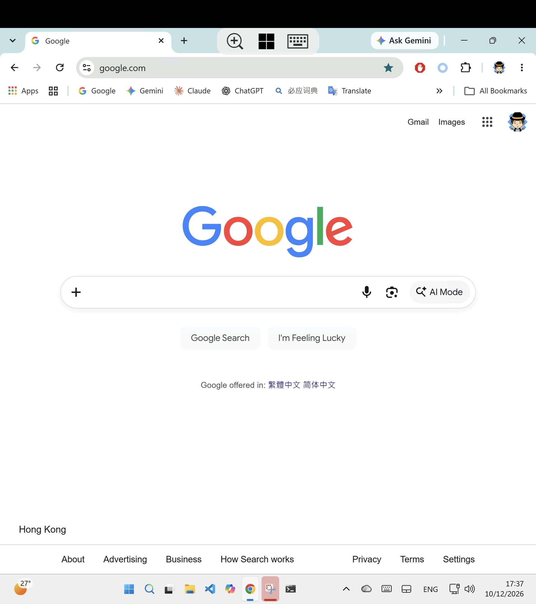
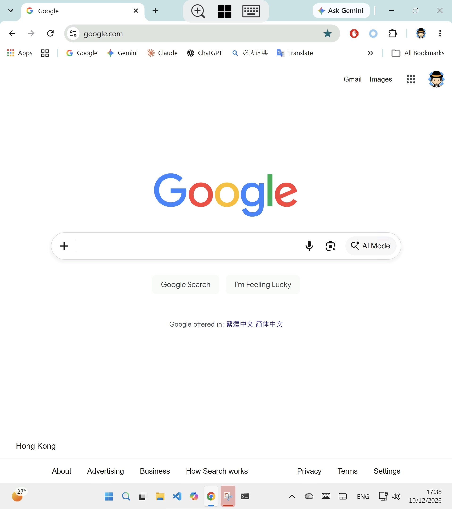

# Windows App fullscreen patcher

Patches Microsoft's **Windows App** for Android (`com.microsoft.rdc.androidx`, formerly Remote Desktop) so the remote desktop fills the entire screen on phones with a display cutout. Without the patch, the app leaves a black band where the camera is.

On foldables with the inner camera in a corner (e.g. Xiaomi Mix Fold 3), Android reports a camera-height strip across the whole top edge. The app pads the session by that strip and also subtracts it from the remote desktop size. Neither can be turned off in the app or in Android settings without root. This patch removes both, so the session uses the full screen. The camera then covers a small area in the corner of the remote desktop.

| Official Windows App | Patched ("Windows App Fullscreen") |
|---|---|
|  |  |
| A black band runs across the top of the session, and the remote desktop is sized to the area below it. | The remote desktop fills the entire screen at full resolution (1916×2160 on the Mix Fold 3's inner display). |

## Download

Get the latest APK from [Releases](../../releases). Each release has two builds:

| File | Package | Notes |
|---|---|---|
| `WindowsApp-<ver>-side-by-side.apk` | `com.cyyself.windowsapp` | Installs **next to** the official app as "Windows App Fullscreen". |
| `WindowsApp-<ver>-nocutout.apk` | `com.microsoft.rdc.androidx` | Replaces the official app. Uninstall the official app first (this deletes its saved PCs and settings). |

Releases are built automatically by CI from the official Google Play APK. The patcher refuses any input that isn't signed with Microsoft's certificate.

### Limitations

- The APK is re-signed, so **Play Store updates won't apply**. Install newer releases from this repo instead (they share one signing key, so they install over each other and keep your data).
- **Work/school (Entra ID) sign-in may fail**, because Microsoft's sign-in checks the app signature. Connecting directly to a PC by hostname/IP with a username and password works.
- Not affiliated with or endorsed by Microsoft.

## Patch locally

Requirements: Java 17+, [apktool](https://apktool.org) 3.x (or `APKTOOL_JAR=/path/apktool.jar`), Android SDK build-tools (`ANDROID_HOME`), Python 3.

```sh
./patch.sh official.apk                  # same package id, replaces the official app
./patch.sh --side-by-side official.apk   # com.cyyself.windowsapp, installs alongside
adb install -r --user 0 work/out/WindowsApp-*-side-by-side.apk
```

Use `--user 0` so adb installs only into your main profile; see [Troubleshooting](#troubleshooting) for why.

To get `official.apk`, pull it from a phone that has the official app installed:

```sh
adb pull "$(adb shell pm path com.microsoft.rdc.androidx | head -1 | cut -d: -f2)" official.apk
```

Or download it with [apkeep](https://github.com/EFForg/apkeep) via `scripts/download.sh <dir>` (see the CI section below for credentials).

Without signing variables, `patch.sh` creates `work/patch.keystore` (password `android`) and reuses it. Set `KEYSTORE`, `KEYSTORE_PASS`, `KEY_ALIAS`, `KEY_PASS` to use your own key. `PACKAGE_ID` / `APP_LABEL` override the side-by-side id and name.

## What the patch changes

All edits are in [`scripts/patch_smali.py`](scripts/patch_smali.py). Obfuscated names are found by what the code does rather than by name. Each step fails the build if it doesn't match, so an app update can't silently produce an unpatched APK.

1. Removes `Modifier.windowInsetsPadding(WindowInsets.displayCutout)` from the Compose session screen. This exists up to 11.0.26071; Microsoft removed it in 11.0.26081, and the patcher skips it when absent.
2. Treats `DisplayCutout.getSafeInset*()` as 0 where the app computes the remote desktop resolution (`ScreenDimensions`, `DisplayInfoProvider`).
3. Stops the session root view from being padded by `systemBars | displayCutout` insets. The system bars are hidden during a session, so only the cutout was contributing.
4. *(side-by-side only)* Renames the application id, the provider authorities, the custom permission and the deep-link host. It also renames the app's internal intent actions (`com.microsoft.windowsapp.action.SESSION_START`, `EDIT_CONNECTION`, …) so each app only opens its own screens. Finally it changes the launcher label.

## Troubleshooting

### Android asks which app to use when connecting, then remembers the choice

Windows App starts sessions with an implicit intent (`com.microsoft.windowsapp.action.SESSION_START`). Side-by-side builds made before the action-renaming fix declare the same action as the official app. Android therefore offers a chooser, and picking **Always** makes one app keep opening sessions in the other. Install a current side-by-side build, then clear the remembered choice:

```sh
adb shell cmd package clear-package-preferred-activities com.cyyself.windowsapp
adb shell cmd package clear-package-preferred-activities com.microsoft.rdc.androidx
```

Without adb: *Settings → Apps → Windows App Fullscreen (and Windows App) → Open by default → Clear defaults*.

Opening a `.rdp` file or an `rdp://` link still offers both apps; that's expected.

### Google Play: "another user has already installed an incompatible version"

Without `--user 0`, `adb install` installs into **every** user profile, including HyperOS/MIUI Security space, Second space and Dual apps. A re-signed `com.microsoft.rdc.androidx` (the `nocutout` build) left in any profile blocks the official app. Find and remove it:

```sh
adb shell pm list users
adb shell pm list packages --user <id> com.microsoft.rdc.androidx
adb shell pm uninstall --user <id> com.microsoft.rdc.androidx
```

### `INSTALL_FAILED_USER_RESTRICTED` on Xiaomi

Enable *Developer options → Install via USB*, keep the phone unlocked, and tap **Install** on the confirmation dialog within a few seconds.

## CI: automatic releases

[`.github/workflows/release.yml`](.github/workflows/release.yml) runs daily, on manual dispatch, and on every push to `main`/`master` (except pushes that only change Markdown or `docs/`). It downloads the latest APK and computes its SHA-256. It skips the run if release `v<version>-r<PATCH_REVISION>` already lists that hash; otherwise it patches both builds and publishes them to GitHub Releases. If the same version comes back with a different hash, the assets are rebuilt and replaced. Bump [`PATCH_REVISION`](PATCH_REVISION) when the patch itself changes, so existing versions get re-released. Manual runs can set `force` to rebuild anyway. Pushes always build both APKs, so patcher changes get tested against the current official APK; the APKs are attached to the run as artifacts for 14 days. A push publishes a release only under the same rule as the daily run.

Repository **secrets**:

| Secret | Purpose |
|---|---|
| `KEYSTORE_BASE64` | `base64 -i patch.keystore` (required; keep it forever, a new key means users must uninstall) |
| `KEYSTORE_PASSWORD` | keystore password |
| `KEY_ALIAS` | key alias (default `patch`) |
| `KEY_PASSWORD` | key password (defaults to the keystore password) |
| `GP_EMAIL` | Google account used to download from Google Play |
| `GP_AAS_TOKEN` | AAS token for that account (see below) |

Getting an AAS token (per [apkeep's Google Play docs](https://github.com/EFForg/apkeep/blob/master/USAGE-google-play.md)): sign in at <https://accounts.google.com/EmbeddedSetup>, copy the `oauth_token` cookie from your browser's dev tools, then run:

```sh
apkeep -e you@gmail.com --oauth-token 'oauth2_4/...'
```

It prints the long-lived AAS token. Use a secondary Google account.

If the Google Play secrets are missing or the Play download fails, CI falls back to APKPure. APKPure is a third-party mirror, but the patcher still verifies Microsoft's signing certificate, so a tampered APK is rejected. The release notes say which source was used. To disable the fallback, set the repository **variable** `ALLOW_APKPURE=0`. (Run locally, `scripts/download.sh` only falls back when `ALLOW_APKPURE=1` is set.)

## License

The scripts in this repo are provided as-is. Windows App is © Microsoft; this repository does not contain or redistribute its code. Releases contain a patched build of it, so publish them at your own discretion.
